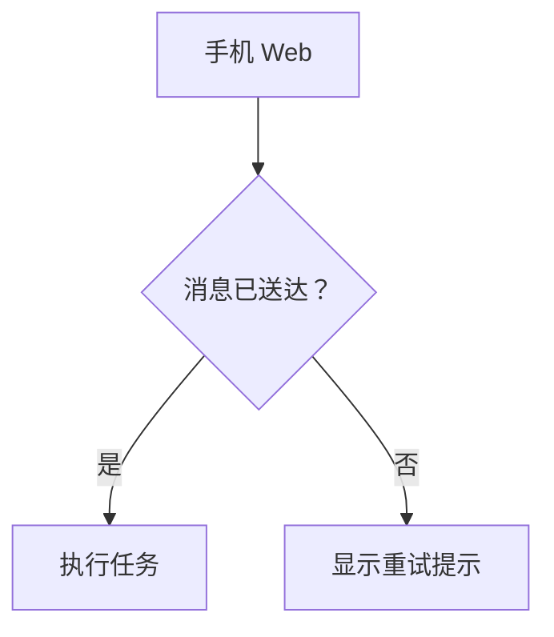
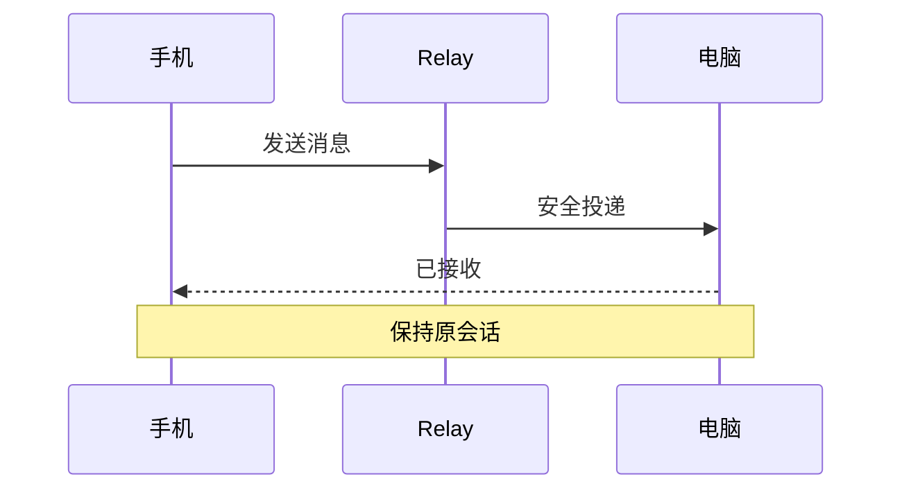
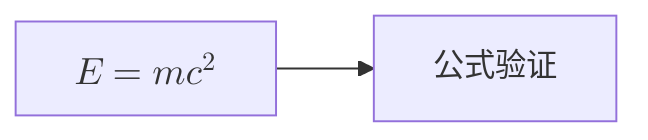

# Mermaid 12 migration / Mermaid 12 迁移验证

2026-10-22 · After / 基于 v0.4.5

## Scope / 范围

- Merge PR #27: Mermaid 11.17.2 → 12.2.0; KaTeX 0.16.47 → 0.18.10.
- Explicitly choose `layout: dagre`, `look: classic` and the existing `base` dark palette. Keep lazy imports, strict security, SVG sanitization and source fallback. Diagram dimensions can still change between major versions.
- 升级后显式保留 Dagre 布局、经典外观及已有暗色配色；继续按需加载、严格安全配置、SVG 清理和失败源码回退。大版本升级仍可能改变节点尺寸，不能承诺逐像素一致。
- Node.js 22.12+ is required. Mermaid upstream targets ES2024 / Safari 17.4+; bundling does not by itself prove compatibility with older phone engines. [Upstream migration notes](https://github.com/mermaid-js/mermaid/releases/tag/mermaid%4012.0.0).

## Verified / 已验证

A local production-build fixture uses the actual `MessageMarkdown` and `MermaidDiagram` components, with the same seven examples before and after the upgrade. Chrome desktop and a 390 px viewport render flowcharts, sequence, class, state, ER, formula and mindmap examples successfully. Invalid syntax falls back to readable source; no uncaught browser errors were observed.

本地生产构建夹具复用真实 Markdown 与图表组件；桌面宽度和 390 px 窄屏下，流程图、时序图、类图、状态图、ER 图、公式和思维导图均通过。无效语法回退源码，未观察到未捕获的浏览器错误。

Network inspection confirms that ordinary text does not fetch Mermaid and that these examples do not fetch ELK. Local timing is only a development comparison, not a phone benchmark. All 631 main tests, four TypeScript checks, Web/Node builds and documentation checks passed. Both full and production-dependency audits against the official npm registry reported zero vulnerabilities at validation time.

网络记录确认普通文本不加载 Mermaid，默认图表不加载 ELK。本机耗时不能代表手机性能。631 项主测试、四项类型检查、Web/Node 构建及文档检查通过；验证时官方 npm 源全量及生产依赖审计均为零告警。

## Phone acceptance / 手机验收（待完成）

Refresh Web after deployment, then view the diagrams below in a Markdown preview or conversation. Confirm Chinese labels and arrowheads are visible, no black blocks or source-fallback notice appears, and scrolling and switching conversations remain responsive. Also open an existing larger diagram. Report the phone/browser version and affected diagram if anything fails.

部署后刷新 Web，在 Markdown 预览或会话中查看下列图表：确认中文、连线与箭头完整，没有黑块或渲染失败提示；上下滚动、切换会话无明显卡顿。再打开一张已有的复杂图表。发现问题时反馈手机/浏览器版本和对应图表。

